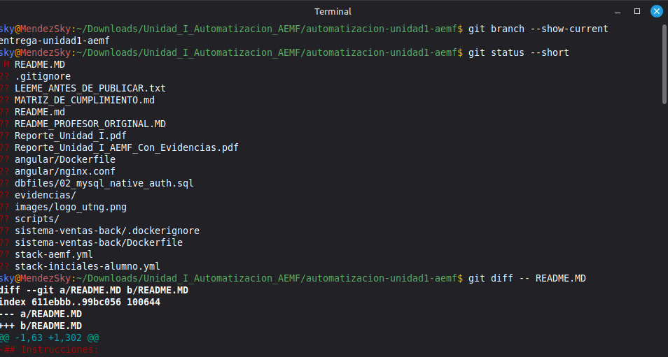
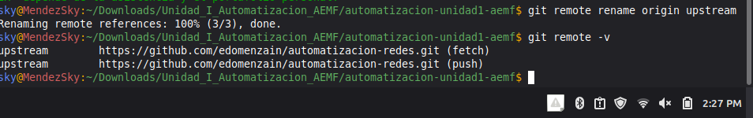

<p align="center">
  
</p>

# Universidad Tecnológica del Norte de Guanajuato

## Automatización de Infraestructura Digital — Unidad I

**Carrera:** Ingeniería en Redes Inteligentes y Ciberseguridad  
**Actividad:** Ordinario — Entornos de desarrollo en la automatización de redes  
**Alumno:** Méndez Fernández Alan Eusebio  
**Grupo:** GIRI6091  
**Número de control:** 1223100825  
**Fecha:** 12 de octubre de 2026  
**Proyecto base:** [Repositorio proporcionado por el profesor](https://github.com/edomenzain/automatizacion-redes)

## Contenido

1. Introducción
2. Objetivo
3. Herramientas utilizadas
4. Instalación y configuración del entorno
5. Configuración del sistema de ventas
6. Pruebas y capturas
7. Publicación en GitHub
8. Resultados obtenidos
9. Conclusión
10. Recursos consultados
11. Referencias bibliográficas

## 1. Introducción

En esta actividad trabajé con Docker para poner en funcionamiento un sistema de ventas que nos proporcionó el profesor. La idea era preparar un entorno donde pudiera ejecutar varias partes de una aplicación sin tener que instalar cada una directamente en mi equipo. Antes de comenzar, ya tenía algunas herramientas instaladas en Linux, así que primero revisé sus versiones y confirmé que estuvieran funcionando. Después descargué el repositorio de la práctica y preparé los archivos que necesitaba para levantar la aplicación.

El sistema está dividido en cuatro servicios. Por un lado está el frontend, que es la página con la que interactúa el usuario. También tiene un backend desarrollado con Node.js, encargado de atender las peticiones y consultar la información. Para guardar los datos utiliza MySQL y para revisar la base de datos se usa phpMyAdmin. Todos estos servicios tenían que trabajar juntos, respetando los nombres, puertos y versiones indicados en la rúbrica.

Durante el desarrollo utilicé Docker Desktop y Docker Compose, además de Git y Visual Studio Code. Con Docker Compose pude colocar la configuración en archivos YAML y manejar los contenedores del mismo proyecto. Git me sirvió para organizar los cambios y publicar mi trabajo en GitHub, conservando el enlace al repositorio original del profesor.

No todo funcionó desde el primer intento. Aunque las imágenes se construyeron, el backend presentó un error al conectarse con MySQL. Revisé los mensajes de error, identifiqué el problema de autenticación y apliqué un ajuste al usuario de la base de datos de esta práctica. Después pude comprobar que los cuatro servicios estaban activos y entrar al sistema de ventas. En este README explico los pasos que seguí, los comandos que utilicé, las pruebas que realicé y las capturas que guardé como parte del trabajo.

## 2. Objetivo

Instalar, configurar y comprobar un entorno de trabajo para automatización usando Docker y Docker Compose. Para ello desplegué el sistema de ventas del profesor, formado por un frontend, un backend, MySQL y phpMyAdmin, y documenté las pruebas realizadas en Linux.

## 3. Herramientas utilizadas

### 3.1 Docker Engine

Docker permite ejecutar aplicaciones dentro de contenedores. Cada contenedor incluye lo necesario para que funcione su servicio, sin mezclar sus dependencias con las de otros programas instalados en el equipo. En esta actividad lo utilicé para ejecutar MySQL, phpMyAdmin, el backend y el frontend. También aprendí a distinguir una **imagen**, que sirve como base para crear el contenedor, de un **contenedor**, que es el servicio cuando ya está creado o en ejecución. Otro elemento importante es el **volumen**, porque guarda los datos de MySQL aunque un contenedor se detenga.

### 3.2 Docker Compose

Docker Compose me permitió definir los cuatro servicios dentro de un archivo `.yml`, en lugar de iniciar cada contenedor por separado. Ahí coloqué los puertos, nombres de servicios, imágenes, variables de entorno, volúmenes y dependencias. Para esta actividad utilicé `stack-iniciales-alumno.yml` y `stack-aemf.yml`, que tienen la configuración de la misma aplicación. Con `docker compose up -d --build` se construyen las imágenes necesarias y se ponen en marcha los servicios.

### 3.3 Docker y Swagger

En la rúbrica se menciona Docker Swagger. Swagger se utiliza para describir y consultar los servicios de una API, por ejemplo mediante Swagger UI y una especificación OpenAPI. También se puede ejecutar Swagger UI dentro de Docker. En el repositorio del profesor no encontré una especificación OpenAPI que hubiera que levantar como un servicio adicional, así que expliqué para qué sirve sin modificar la aplicación para agregar algo que no venía en el ejercicio.

### 3.4 Visual Studio Code y extensiones

Usé Visual Studio Code para revisar los Dockerfile, los archivos YAML, la configuración de Nginx y el README. Las extensiones de Docker y Containers ayudan a trabajar con contenedores; la extensión YAML facilita la lectura de los archivos de configuración, y GitLens permite revisar los cambios de Git. En mi equipo comprobé que estas extensiones estaban instaladas.

### 3.5 Git y GitHub

Con Git fui registrando los cambios del proyecto. GitHub me permitió guardar la entrega en un repositorio personal para que el profesor pueda revisar el código, los archivos de configuración y las evidencias. No subí los cambios al repositorio original: lo dejé como referencia con el nombre `upstream` y usé `origin` para mi repositorio.

## 4. Instalación y configuración del entorno

### 4.1 Revisión de las herramientas en Linux

Lo primero que hice fue comprobar las versiones de los programas con los que iba a trabajar. Como ya tenía Docker Desktop, Git y VS Code instalados, no fue necesario volver a instalarlos para realizar la práctica.

```bash
uname -a
cat /etc/os-release
code --version
git --version
docker --version
docker compose version
docker desktop status
code --list-extensions
```

Estos fueron los datos que obtuve en la terminal:

| Herramienta | Versión o resultado |
|---|---|
| Visual Studio Code | 1.141.0 |
| Git | 2.43.0 |
| Docker (cliente) | 29.9.0 |
| Docker Compose | v5.5.1 |
| Docker Desktop | `running` |
| Extensiones | Docker, Containers, YAML y GitLens, entre otras |


### 4.2 Cómo se instalan las herramientas

Para que también quede explicado el proceso de instalación, estos son los pasos correspondientes a un equipo con Ubuntu o una distribución basada en Debian. En mi computadora utilicé las instalaciones que ya tenía y comprobé su funcionamiento; los siguientes comandos quedan documentados para preparar otro equipo.

**Git.** Se puede instalar desde la terminal con:

```bash
sudo apt update
sudo apt install -y git
git --version
```

En mi caso, al ejecutar `sudo apt install git -y`, el sistema indicó que Git ya estaba instalado y que no había paquetes nuevos que agregar.

**Visual Studio Code.** Se descarga el paquete para Linux desde la [página oficial](https://code.visualstudio.com/download). Una vez descargado el archivo `.deb`, se puede instalar desde la carpeta donde se encuentre:

```bash
sudo apt install ./NOMBRE_DEL_ARCHIVO.deb
code --version
```

Para los complementos usados en esta actividad, los comandos son:

```bash
code --install-extension ms-azuretools.vscode-docker
code --install-extension ms-azuretools.vscode-containers
code --install-extension redhat.vscode-yaml
code --install-extension eamodio.gitlens
code --list-extensions
```

**Docker.** Para instalar Docker Engine en Ubuntu hay que agregar primero el repositorio oficial y después instalar los paquetes. El procedimiento de referencia es el siguiente:

```bash
sudo apt update
sudo apt install -y ca-certificates curl
sudo install -m 0755 -d /etc/apt/keyrings
sudo curl -fsSL https://download.docker.com/linux/ubuntu/gpg -o /etc/apt/keyrings/docker.asc
sudo chmod a+r /etc/apt/keyrings/docker.asc

echo "deb [arch=$(dpkg --print-architecture) signed-by=/etc/apt/keyrings/docker.asc] https://download.docker.com/linux/ubuntu $(. /etc/os-release && echo ${UBUNTU_CODENAME:-$VERSION_CODENAME}) stable" | sudo tee /etc/apt/sources.list.d/docker.list > /dev/null

sudo apt update
sudo apt install -y docker-ce docker-ce-cli containerd.io docker-buildx-plugin docker-compose-plugin
```

También se puede utilizar Docker Desktop. En Linux es necesario tener disponible la virtualización KVM y descargar el paquete `.deb` desde el [sitio oficial de Docker Desktop](https://docs.docker.com/desktop/setup/install/linux/). Si el archivo se encuentra en Descargas, se instala indicando su ruta real; después se inicia el servicio del usuario y se selecciona el contexto:

```bash
sudo apt install /ruta/al/archivo/docker-desktop-amd64.deb
systemctl --user start docker-desktop
docker context use desktop-linux
docker desktop status
```

**En mi equipo no ejecuté estas instalaciones desde cero**, porque Docker Desktop ya estaba instalado. Lo que sí comprobé fue que el contexto `desktop-linux` se conectara al servidor y que `hello-world` funcionara. Docker Compose venía disponible con Docker y lo revisé con `docker compose version`. Para una instalación nueva es importante seguir la versión más reciente de las [instrucciones oficiales de Docker](https://docs.docker.com/engine/install/ubuntu/).

### 4.3 Descarga del proyecto del profesor

Tomé como base el repositorio indicado en el instrumento. El comando para descargarlo es:

```bash
git clone https://github.com/edomenzain/automatizacion-redes.git
cd automatizacion-redes
```

Para la entrega trabajé sobre la revisión `4e50b4c66092384d27a92265e29a81fbda44205d`, con una rama llamada `entrega-unidad1-aemf`. También guardé el README original del docente en `docs/README_PROFESOR_ORIGINAL.MD` para conservar las instrucciones con las que comencé.

## 5. Configuración del sistema de ventas

### 5.1 Los cuatro servicios

En el archivo `stack-iniciales-alumno.yml` coloqué los servicios solicitados. También dejé `stack-aemf.yml` con la misma configuración para trabajar usando mis iniciales.

| Servicio | Imagen utilizada | Nombre del contenedor | Puerto de mi equipo |
|---|---|---|---|
| MySQL | `mysql:8.0` | `mysql-db` | `3306` |
| phpMyAdmin | `phpmyadmin:latest` | `phpmyadmin` | `9090` |
| Backend | `node:18.17.1-alpine` | `sistema-ventas-back` | `8080` |
| Frontend | `nginx:stable-alpine` | `sistema-ventas-front` | `80` |

Para MySQL utilicé la base `sistema_ventas_db`, el usuario `admin` y las contraseñas de prueba indicadas por el profesor. Su información se guarda en el volumen `dbfiles`. Además, el SQL `dbfiles/sistema_ventas_db_rev1.1.sql` contiene las tablas y los datos iniciales de la aplicación.

### 5.2 Dockerfile del backend

En `sistema-ventas-back/Dockerfile` utilicé Node.js `18.17.1-alpine`, tal como se pide en el instrumento. El archivo crea la carpeta `/usr/src/app`, copia `package.json` y `package-lock.json`, instala las dependencias con `npm install`, copia el resto del backend, expone el puerto `3000` y ejecuta `node index.js`. Desde mi computadora accedo al backend por el puerto `8080`, que Docker redirige al `3000` del contenedor.

### 5.3 Dockerfile del frontend

Para el frontend utilicé `nginx:stable-alpine`. Su Dockerfile declara el volumen `/temp`, limpia la carpeta donde Nginx publica las páginas y copia `nginx.conf`, `mime.types` y los archivos de `sistema-ventas-front`. El servicio escucha en el puerto `80` y se inicia con `nginx -g 'daemon off;'`.

### 5.4 Levantar los contenedores

Antes de ejecutar los servicios revisé que estuvieran libres los puertos 80, 3306, 8080 y 9090. Después validé el YAML, construí las imágenes y comprobé el estado de los contenedores.

```bash
sudo ss -ltnp | grep -E ':(80|3306|8080|9090)\b' || true

docker compose -f stack-aemf.yml config -q
docker compose -f stack-aemf.yml up -d --build
docker compose -f stack-aemf.yml ps -a
docker compose -f stack-aemf.yml logs --tail 100
```

La aplicación quedó organizada de esta manera:

```text
Navegador
  |-- localhost:80 -----> Frontend Nginx (Angular)
  |-- localhost:8080 ---> Backend Node.js (puerto 3000)
  |                          |
  |                          v
  |                       MySQL (mysql-db:3306)
  |                          |
  |                       Volumen dbfiles
  |
  `-- localhost:9090 ---> phpMyAdmin ---> MySQL
```

Para detener solamente los contenedores de esta práctica puedo utilizar `docker compose -f stack-aemf.yml down`. No usé `down -v`, porque esa opción también borraría el volumen donde se guardan los datos de MySQL.

## 6. Pruebas y capturas

### 6.1 Primera prueba: hello-world

Empecé con la prueba más básica de Docker:

```bash
docker run --rm hello-world
```

En la terminal apareció `Hello from Docker!`, lo que confirmó que Docker podía descargar una imagen y ejecutar un contenedor.


### 6.2 Revisión de Docker Compose

Después validé el archivo YAML y levanté la aplicación con los comandos indicados en el apartado 5. Al revisar el resultado, MySQL y el backend aparecieron como `healthy`, mientras que el frontend y phpMyAdmin estaban en ejecución. De esta forma comprobé que los cuatro servicios estaban activos.

### 6.3 Respuesta del backend

Para revisar el backend ejecuté:

```bash
curl -i http://localhost:8080/
```

Obtuve una respuesta HTTP `200 OK` y el mensaje `"API is located at /api"`. También abrí esa dirección en el navegador.


### 6.4 Base de datos y phpMyAdmin

Entré a phpMyAdmin desde `http://localhost:9090/` usando el servidor `mysql-db`. Ahí pude ver la base de datos `sistema_ventas_db` creada con la información del proyecto.


También utilicé este comando para consultar las tablas y revisar el usuario cargado por el SQL:

```bash
docker exec mysql-db sh -c 'MYSQL_PWD=admin mysql -uadmin sistema_ventas_db -e "SHOW TABLES; SELECT username FROM tbl_usuario LIMIT 3;"'
```

Entre las tablas del proyecto están `tbl_usuario`, `tbl_rol`, `tbl_rol_usuario`, `tbl_categoria`, `tbl_producto`, `tbl_venta`, `tbl_detalle_venta` y `tbl_imagen_producto`.

### 6.5 Página de inicio e ingreso como administrador

Abrí `http://localhost/home` y apareció la página principal del sistema de ventas.


Luego inicié sesión con el usuario `admin` y la contraseña `12345678`, que son los datos de prueba proporcionados para esta actividad. El sistema me permitió acceder a la sección de usuarios del administrador.


La autenticación también se puede consultar desde la API con:

```bash
curl -i -X POST http://localhost:8080/api/auth \
  -H 'Content-Type: application/json' \
  -d '{"username":"admin","password":"12345678"}'
```

Si se guarda la respuesta de esa petición, es importante ocultar el token JWT antes de subirla a GitHub. El script de pruebas genera una versión sin el token.

### 6.6 Error que encontré y cómo lo resolví

Al principio el backend no funcionaba bien. En Docker aparecía `unhealthy` y, cuando abría `localhost:8080`, respondía con un error `500`. MySQL sí estaba funcionando, por lo que revisé la conexión desde el contenedor de Node.js. Ahí apareció el error `ER_NOT_SUPPORTED_AUTH_MODE`.

El problema era que el usuario `admin` de MySQL estaba usando `caching_sha2_password` y el cliente de base de datos que trae el proyecto no era compatible con ese método. Para solucionarlo, cambié la autenticación de ese usuario a `mysql_native_password` dentro del MySQL de esta práctica. Después la página del backend respondió con HTTP `200` y los cuatro servicios pudieron iniciarse correctamente.

Dejé ese mismo ajuste en `dbfiles/02_mysql_native_auth.sql`, que está referenciado en los dos archivos Compose para las instalaciones nuevas. La solución manual quedó comprobada con la base que ya tenía funcionando. No eliminé mi volumen de datos para repetir la prueba desde cero. `mysql_native_password` y las contraseñas del ejemplo se utilizan solo para este laboratorio, no como configuración recomendada para producción.

### 6.7 Script de verificación

Dentro de `scripts/verificar.sh` dejé reunidas las comprobaciones principales: versiones, `hello-world`, validación del YAML, estado de contenedores, respuesta del backend, base de datos e inicio de sesión.

```bash
./scripts/verificar.sh
```

Los resultados de estas pruebas se pueden guardar en `evidencias/salidas/`. Las capturas que aparecen en este reporte son las que obtuve durante el trabajo en mi equipo.

## 7. Publicación en GitHub

Para entregar mi práctica creé el repositorio [automatizacion-infraestructura-digital-u1](https://github.com/RoxyRg/automatizacion-infraestructura-digital-u1) en mi cuenta de GitHub. Estos fueron los pasos que seguí:

### 7.1 Preparé mi rama de trabajo

Descargué el repositorio del profesor y utilicé la rama `entrega-unidad1-aemf` para mantener organizados mis archivos. Revisé los cambios con:

```bash
git branch --show-current
git status --short
```



### 7.2 Separé el repositorio del profesor del mío

Para no enviar cambios al repositorio original, cambié el nombre de su remoto a `upstream`:

```bash
git remote rename origin upstream
git remote -v
```



### 7.3 Creé y conecté mi repositorio

En GitHub creé un repositorio público llamado `automatizacion-infraestructura-digital-u1`, sin agregar otro README desde la página. Después configuré el remoto `origin` con la dirección de mi repositorio:

```bash
git remote add origin https://github.com/RoxyRg/automatizacion-infraestructura-digital-u1.git
git remote -v
```

### 7.4 Guardé los cambios y los publiqué

Revisé qué archivos iba a subir, preparé los del proyecto con `git add` y guardé el primer commit. Después publiqué la rama en GitHub.

```bash
git add README.md angular/Dockerfile angular/nginx.conf \
  sistema-ventas-back/Dockerfile stack-aemf.yml \
  stack-iniciales-alumno.yml dbfiles/02_mysql_native_auth.sql

git diff --cached --stat
git commit -m "Entrega Unidad I - Automatizacion de Infraestructura Digital"
git push -u origin HEAD:main
```

El primer commit fue `89a6a04`. Después actualicé el README y el PDF y publiqué esos cambios con el commit `b87a656`. El resultado se puede consultar en [mi repositorio](https://github.com/RoxyRg/automatizacion-infraestructura-digital-u1). También guardé una comprobación de la rama remota en `evidencias/salidas/13-git-publicacion.txt`.

## 8. Resultados obtenidos

Al terminar las pruebas, pude comprobar lo siguiente:

| Parte revisada | Lo que observé |
|---|---|
| Docker | La imagen `hello-world` se ejecutó y mostró el mensaje de éxito. |
| Docker Compose | Los cuatro servicios quedaron en ejecución. |
| Backend | Respondió con HTTP `200` en el puerto `8080`. |
| MySQL | La base `sistema_ventas_db` quedó disponible. |
| phpMyAdmin | Pude entrar y revisar la base de datos. |
| Frontend | Abrió la página de inicio y pude entrar al área administrativa. |
| Herramientas | Comprobé las versiones de VS Code, Git, Docker y Compose. |
| GitHub | Publiqué el código, el README, el PDF y las capturas en mi repositorio. |

## 9. Conclusión

**Méndez Fernández Alan Eusebio**

En esta práctica aprendí que trabajar con Docker no es solamente descargar imágenes y prender contenedores. Para que una aplicación funcione se necesita revisar cómo se conectan sus servicios, qué puertos utiliza cada uno y de dónde obtiene los datos. Al principio pensé que, si Docker lograba construir las imágenes, ya tendría casi todo listo. Sin embargo, cuando intenté abrir el backend me encontré con un error y tuve que revisar con más detalle la configuración.

Lo que más trabajo me dio fue la conexión entre Node.js y MySQL. El contenedor de MySQL aparecía saludable, pero el backend seguía respondiendo con un error 500. Primero revisé los registros y después hice una prueba directa de conexión desde el contenedor. Así encontré el mensaje `ER_NOT_SUPPORTED_AUTH_MODE` y pude identificar que se trataba del método de autenticación. Una vez que ajusté el usuario de la base de datos para esta práctica, el backend comenzó a responder correctamente. Eso me ayudó a entender que un contenedor puede estar encendido y aun así tener problemas para realizar su función.

También me sirvió aprender a usar Docker Compose, porque tener todos los servicios descritos en un mismo archivo facilita revisar sus configuraciones y volver a iniciarlos cuando sea necesario. Me quedó más claro para qué sirven los volúmenes, especialmente en MySQL, donde no quiero perder las tablas ni los usuarios cada vez que detengo un contenedor. Además, pude comprobar la diferencia entre acceder a un servicio desde el navegador mediante `localhost` y comunicar contenedores usando nombres internos como `mysql-db`.

Otra parte importante fue trabajar con Git. Antes de publicar, revisé los archivos que había modificado y separé el repositorio del profesor de mi propio repositorio para no confundir los cambios. Después hice el commit y comprobé que apareciera en GitHub. Al finalizar, tenía el sistema de ventas funcionando, sus configuraciones guardadas y las capturas de las pruebas. Me llevo de esta actividad la importancia de revisar los errores con calma, entender qué está fallando y dejar escrito el procedimiento para poder repetirlo más adelante.

## 10. Recursos consultados

Para realizar la práctica consulté el repositorio del profesor y documentación de las herramientas utilizadas:

| Recurso | Para qué lo utilicé |
|---|---|
| [Repositorio del profesor](https://github.com/edomenzain/automatizacion-redes) | Código del sistema de ventas y script SQL. |
| [Docker Docs](https://docs.docker.com/) | Comandos y funcionamiento de contenedores. |
| [Docker Compose](https://docs.docker.com/compose/) | Configuración de servicios en YAML. |
| [Docker Hub: MySQL](https://hub.docker.com/_/mysql) | Imagen de MySQL y opciones de inicialización. |
| [Docker Hub: phpMyAdmin](https://hub.docker.com/_/phpmyadmin) | Imagen de phpMyAdmin. |
| [Documentación de Node.js](https://nodejs.org/en/docs) | Funcionamiento del backend. |
| [Documentación de Nginx](https://nginx.org/en/docs/) | Configuración del frontend. |
| [Swagger](https://swagger.io/docs/) | Conceptos de Swagger y OpenAPI. |
| [VS Code](https://code.visualstudio.com/docs) | Editor y extensiones. |
| [Git](https://git-scm.com/doc) | Comandos para registrar y publicar los cambios. |

## 11. Referencias bibliográficas (APA 7)

<div class="referencias-apa">
<p>Docker, Inc. (s. f.). <em>Docker documentation.</em> https://docs.docker.com/</p>
<p>Docker, Inc. (s. f.). <em>Docker Compose overview.</em> https://docs.docker.com/compose/</p>
<p>Docker, Inc. (s. f.). <em>MySQL - Official image.</em> Docker Hub. https://hub.docker.com/_/mysql</p>
<p>Docker, Inc. (s. f.). <em>phpMyAdmin - Official image.</em> Docker Hub. https://hub.docker.com/_/phpmyadmin</p>
<p>Domenzain, E. (s. f.). <em>Automatización redes</em> [Repositorio de código]. GitHub. https://github.com/edomenzain/automatizacion-redes</p>
<p>Git. (s. f.). <em>Git documentation.</em> https://git-scm.com/doc</p>
<p>NGINX. (s. f.). <em>NGINX documentation.</em> https://nginx.org/en/docs/</p>
<p>OpenAPI Initiative. (s. f.). <em>OpenAPI specification.</em> https://spec.openapis.org/oas/latest.html</p>
<p>Visual Studio Code. (s. f.). <em>Documentation.</em> Microsoft. https://code.visualstudio.com/docs</p>
</div>
