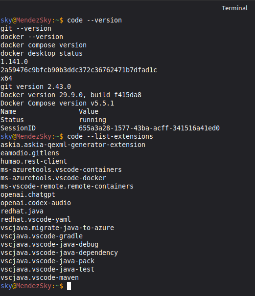

<p align="center">
  
</p>

# Universidad Tecnológica del Norte de Guanajuato (UTNG)

## Ingeniería en Redes Inteligentes y Ciberseguridad

**Asignatura:** Automatización de Infraestructura Digital  
**Unidad I:** Entornos de desarrollo en la automatización de redes  
**Modalidad:** Ordinario  
**Estudiante:** Méndez Fernández Alan Eusebio  
**Grupo:** **GIRI6091**  
**Número de control:** **1223100825**  
**Fecha:** 12 de octubre de 2026  
**Fuente del proyecto:** [Repositorio original del docente](https://github.com/edomenzain/automatizacion-redes)  
**Revisión fuente examinada:** `4e50b4c66092384d27a92265e29a81fbda44205d`

> **Estado de entrega (12 de octubre de 2026):** Se documentó la ejecución auténtica de `hello-world`, Docker Compose, el backend HTTP 200, phpMyAdmin y el frontend con sesión iniciada. Se incluyen siete capturas, entre ellas la verificación de VS Code, Git, Docker Desktop, Docker CLI, Compose y extensiones. Continúan pendientes la prueba de despliegue limpio con el ajuste de MySQL y la publicación de este README en un repositorio propio de GitHub. La asistencia y el portafolio se acreditan por separado.

---

## Índice

1. Introducción
2. Objetivo
3. Desarrollo: descripción de herramientas
4. Procedimiento de instalación y configuración
5. Aplicación del caso de estudio y arquitectura
6. Pruebas de funcionamiento y evidencias
7. Lista de cotejo
8. Conclusión individual
9. Anexo: comunidad y recursos de colaboración
10. Referencias APA 7

## 1. Introducción

La automatización de infraestructura digital es una práctica fundamental para administrar servicios tecnológicos de forma ordenada, reproducible y verificable. En los entornos de redes y sistemas, la instalación manual de aplicaciones puede provocar diferencias de versiones, errores de configuración y problemas al trasladar proyectos de una computadora a otra. Ante esta situación, las herramientas de contenedorización y control de versiones permiten describir un entorno mediante archivos de texto que pueden compartirse, inspeccionarse y ejecutarse siguiendo un procedimiento documentado. En este reporte se presenta la preparación de un entorno de desarrollo basado en Docker Engine, Docker Compose, Git, Visual Studio Code y conceptos asociados con Swagger para la documentación de servicios web.

El caso de estudio de la Unidad I consiste en desplegar el sistema de ventas proporcionado por el docente, sin reemplazar su aplicación original. Dicho sistema consta de un frontend Angular ya compilado, un backend desarrollado con Node.js, un motor de base de datos MySQL y una herramienta de administración phpMyAdmin. El trabajo se organiza a partir de los materiales publicados en el repositorio de referencia y de los requisitos precisos establecidos en el instrumento de evaluación: nombres de contenedores, puertos, imágenes, variables de entorno, dependencias y pasos de construcción de Dockerfile.

La documentación contempla el procedimiento técnico para preparar el equipo de trabajo, crear los archivos de despliegue, iniciar los servicios y comprobar su funcionamiento. También se define una lista de verificación acompañada de los comandos necesarios para generar evidencias auténticas de Docker, de la base de datos y de la aplicación. Finalmente, se integra una reflexión individual sobre la importancia de verificar dependencias y servicios antes de reportar una instalación como satisfactoria. El propósito es relacionar los fundamentos de automatización con una implementación práctica que otro estudiante pueda reproducir en su propia computadora.

## 2. Objetivo

Implementar y documentar un entorno de desarrollo para la automatización de redes mediante Docker y Docker Compose, desplegando una aplicación de ventas compuesta por frontend, backend, MySQL y phpMyAdmin, con pruebas reproducibles y evidencias del funcionamiento.

## 3. Desarrollo: descripción de las herramientas utilizadas

### 3.1 Docker Engine

Docker Engine es la tecnología que permite construir imágenes y ejecutar contenedores aislados con los archivos, dependencias y configuraciones necesarios para una aplicación. En esta actividad administra los cuatro contenedores del sistema de ventas. Los conceptos principales son imagen (plantilla de construcción), contenedor (instancia en ejecución), volumen (almacenamiento persistente) y red de contenedores (comunicación entre servicios). La verificación inicial se realiza con la imagen oficial `hello-world`.

### 3.2 Docker Compose

Docker Compose permite definir un conjunto de servicios en un archivo YAML. En el archivo `stack-iniciales-alumno.yml` se indican las imágenes, la construcción de Dockerfiles, los puertos publicados, las variables de entorno, las dependencias y la persistencia de MySQL. Con `docker compose up -d --build` se construyen las imágenes locales y se inician los servicios. El archivo `stack-aemf.yml` es una copia con las iniciales del estudiante y el mismo contenido.

### 3.3 Docker Swagger

En el instrumento aparece la expresión «Docker Swagger». Para distinguir conceptos, Swagger es un conjunto de herramientas para describir y probar interfaces de programación (API); no es un componente obligatorio de Docker Engine. Swagger UI puede ejecutarse dentro de un contenedor para visualizar una especificación OpenAPI. **El caso de estudio entregado por el profesor no exige instalar un quinto servicio Swagger ni proporciona una especificación OpenAPI**; por ello se documenta su finalidad sin agregar componentes ajenos al despliegue solicitado.

### 3.4 Visual Studio Code y complementos

Visual Studio Code facilita revisar Dockerfiles, YAML, JavaScript, configuraciones de Nginx y documentos Markdown desde un solo entorno. Las extensiones recomendadas para el trabajo son Docker (`ms-azuretools.vscode-docker`), YAML (`redhat.vscode-yaml`) y GitLens (`eamodio.gitlens`). Su instalación y versiones deben verificarse en el equipo donde se realiza la práctica.

### 3.5 Git y GitHub

Git registra cambios locales y permite conservar el historial de creación de archivos. GitHub permite publicar el README y los archivos de configuración en un repositorio propio, manteniendo la atribución al recurso original del docente. El código fuente se obtiene del repositorio `edomenzain/automatizacion-redes` y se trabaja en una rama nueva para esta práctica.

## 4. Procedimiento de instalación y configuración

> Los comandos siguientes documentan el procedimiento para que pueda reproducirse. Docker, Compose, Git, VS Code, las extensiones, `hello-world` y los cuatro servicios se comprobaron durante la práctica. Las capturas de aplicación y versiones se encuentran en el apartado 6.8. Los comandos de instalación son instrucciones de referencia para reproducir el entorno, no constancia de una reinstalación.

### 4.1 Preparación del entorno Linux

Abrir una terminal y consultar información básica:

```bash
uname -a
cat /etc/os-release
git --version
docker --version
docker compose version
code --version
```

Si Git, Docker y VS Code ya están instalados, registrar sus versiones en lugar de reinstalarlos. La instalación de Docker Engine debe seguir la [documentación oficial de la distribución](https://docs.docker.com/engine/install/). En Ubuntu, tras configurar el repositorio oficial de Docker según la guía, los componentes requeridos son `docker-ce`, `docker-ce-cli`, `containerd.io`, `docker-buildx-plugin` y `docker-compose-plugin`.

Para instalar Git en Ubuntu o Debian:

```bash
sudo apt update
sudo apt install -y git curl
```

Para Visual Studio Code, utilizar el paquete correspondiente a la distribución desde el [sitio oficial de VS Code](https://code.visualstudio.com/download). Con el ejecutable `code` disponible, instalar complementos:

```bash
code --install-extension ms-azuretools.vscode-docker
code --install-extension redhat.vscode-yaml
code --install-extension eamodio.gitlens
code --list-extensions
```

**Evidencia obtenida:** `evidencias/capturas/07_versiones_y_extensiones.png`, con resultados reales de `code --version`, `git --version`, `docker --version`, `docker compose version`, `docker desktop status` y `code --list-extensions`. Se identifican VS Code 1.141.0 (x64), Git 2.43.0, Docker CLI 29.9.0, Docker Compose v5.5.1 y el estado `running` de Docker Desktop. También se aprecian las extensiones `ms-azuretools.vscode-docker`, `ms-azuretools.vscode-containers`, `redhat.vscode-yaml` y `eamodio.gitlens`, entre otras. Esta evidencia confirma disponibilidad y versiones, no una nueva instalación de todos los paquetes. Los archivos de salida adicionales se guardan en `evidencias/salidas` cuando se ejecuta el script de pruebas.

### 4.2 Obtención de los archivos proporcionados por el profesor

La base para la práctica se obtiene sin modificar otros proyectos:

```bash
git clone https://github.com/edomenzain/automatizacion-redes.git
cd automatizacion-redes
```

Para reproducir exactamente la revisión usada en este paquete:

```bash
git switch -c entrega-unidad1-aemf 4e50b4c66092384d27a92265e29a81fbda44205d
```

El archivo `iniciar_proyecto.sh` de este paquete automatiza los pasos anteriores y copia únicamente los Dockerfiles, el stack, Nginx, el README y los scripts de verificación. Conserva el `README.MD` original del profesor bajo el nombre `README_PROFESOR_ORIGINAL.MD`.

### 4.3 Construcción de los servicios del proyecto

El archivo `stack-iniciales-alumno.yml` especifica:

| Servicio | Imagen o Dockerfile | Contenedor | Puerto externo → interno | Dependencias |
|---|---|---|---|---|
| phpMyAdmin | `phpmyadmin:latest` | `phpmyadmin` | `9090 → 80` | MySQL saludable |
| MySQL | `mysql:8.0` | `mysql-db` | `3306 → 3306` | Ninguna |
| Backend | `node:18.17.1-alpine` (Dockerfile) | `sistema-ventas-back` | `8080 → 3000` | MySQL saludable |
| Frontend | `nginx:stable-alpine` (Dockerfile) | `sistema-ventas-front` | `80 → 80` | Backend saludable |

La imagen de MySQL recibe `MYSQL_ROOT_PASSWORD=qwerty`, `MYSQL_DATABASE=sistema_ventas_db`, `MYSQL_USER=admin` y `MYSQL_PASSWORD=admin`. El volumen Docker `dbfiles` conserva los datos y el script `dbfiles/sistema_ventas_db_rev1.1.sql` del profesor crea las tablas y registra el usuario administrador **únicamente al inicializar un volumen vacío**. El backend utiliza el nombre de servicio `mysql-db` para conectarse dentro de la red de Compose.

**Importante:** la práctica conserva las contraseñas de ejemplo del material docente porque se trata de un entorno académico local. Estas credenciales no deben reutilizarse en producción. El frontend original contiene una URL de API orientada a `http://localhost:8080/api`, de modo que se mantiene el puerto solicitado y se realizan las pruebas desde el propio equipo.

### 4.4 Backend: Dockerfile

El archivo `sistema-ventas-back/Dockerfile` utiliza Node `18.17.1-alpine`, establece `/usr/src/app`, copia `package.json` y `package-lock.json`, ejecuta `npm install`, copia el proyecto restante, expone `3000` y ejecuta `node index.js`. Esta secuencia coincide con la solicitada en la página 3 del instrumento.

### 4.5 Frontend: Dockerfile

El archivo `angular/Dockerfile` utiliza `nginx:stable-alpine`, declara el volumen `/temp`, limpia `/usr/share/nginx/html/*`, copia `nginx.conf`, copia `mime.types` y publica los archivos compilados desde `angular/sistema-ventas-front`. Por último, expone el puerto `80` y ejecuta `nginx -g 'daemon off;'`, conforme a la página 4.

### 4.6 Ejecutar y gestionar el stack

```bash
# Comprobar que los puertos 80, 3306, 8080 y 9090 estén disponibles
sudo ss -ltnp | grep -E ':(80|3306|8080|9090)\b' || true

# Validar la configuración antes de crear contenedores
docker compose -f stack-aemf.yml config -q

# Construir y levantar
docker compose -f stack-aemf.yml up -d --build

# Mostrar contenedores y logs
docker compose -f stack-aemf.yml ps
docker compose -f stack-aemf.yml logs --tail 100
```

**No ejecutar `docker compose down -v` como rutina** porque eliminaría el volumen de MySQL y sus datos. Para detener solamente esta práctica usar `docker compose -f stack-aemf.yml down`, que conserva el volumen.

## 5. Aplicación del caso de estudio y arquitectura

La aplicación consta de cuatro servicios que se comunican de la siguiente manera:

```text
Navegador Linux
    |-- http://localhost/ ----------> frontend Nginx :80
    |                                      (Angular compilado)
    |-- http://localhost:8080/api/ --> backend Node.js :3000
    |                                      |
    |                                      v
    |                                  mysql-db :3306
    |                                      |
    |                                   dbfiles
    |
    `-- http://localhost:9090/ ----> phpMyAdmin :80
                                           |
                                           v
                                      mysql-db :3306
```

El frontend presenta la pantalla de inicio y permite iniciar sesión con el usuario de práctica `admin` y contraseña `12345678`, tal como indica el instrumento. El backend debe contestar en `http://localhost:8080/` con el JSON `"API is located at /api"`. phpMyAdmin debe mostrar la base de datos `sistema_ventas_db` y las tablas importadas desde el SQL del profesor. La existencia de código o archivos **no sustituye la verificación de estas salidas en ejecución**.

## 6. Pruebas de funcionamiento y evidencias

### 6.1 Prueba básica de Docker

```bash
docker run --rm hello-world
```

**Criterio de aceptación:** se observa el mensaje de éxito de la imagen oficial, emitido por Docker durante la ejecución. **Evidencia real:** salida mostrada en terminal (y, si existe, `evidencias/salidas/02-hello-world.txt`) y captura `evidencias/capturas/01_hello_world.png`.

### 6.2 Archivo YAML y contenedores

```bash
docker compose -f stack-aemf.yml config -q
docker compose -f stack-aemf.yml up -d --build
docker compose -f stack-aemf.yml ps
```

**Criterio de aceptación:** los cuatro servicios aparecen en funcionamiento, MySQL y backend completan sus healthchecks, y no existen errores de construcción o de arranque. **Evidencias:** `03-compose-config.txt`, `04-build-up.txt`, `05-contenedores.txt` y capturas equivalentes.

### 6.3 Backend HTTP

```bash
curl -i http://localhost:8080/
```

**Criterio de aceptación:** HTTP `200` con el texto JSON `"API is located at /api"` entregado por el backend del profesor. **Evidencia:** `06-backend.json` más captura del navegador.

### 6.4 Base de datos

```bash
docker exec mysql-db sh -c 'MYSQL_PWD=admin mysql -uadmin sistema_ventas_db -e "SHOW TABLES; SELECT username FROM tbl_usuario LIMIT 3;"'
```

**Criterio de aceptación:** aparecen las tablas `tbl_rol`, `tbl_usuario`, `tbl_rol_usuario`, `tbl_categoria`, `tbl_producto`, `tbl_imagen_producto`, `tbl_venta` y `tbl_detalle_venta`, y el usuario `admin` precargado. **Evidencia:** `09-mysql.txt` y captura de phpMyAdmin.

### 6.5 Inicio de sesión frontend/API

```bash
curl -i -X POST http://localhost:8080/api/auth \
  -H 'Content-Type: application/json' \
  -d '{"username":"admin","password":"12345678"}'
```

**Criterio de aceptación:** respuesta HTTP `200` con un token válido y mensaje de autenticación correcta; se debe ocultar el JWT si se adjunta una salida o captura. Además, probar en navegador el login original desde `http://localhost/`. La verificación automatizada genera `10-login-sin-token.json` con el token oculto cuando la prueba es exitosa.

### 6.6 Ejecución integral de pruebas

El siguiente script levanta el stack y genera automáticamente archivos de texto con evidencia de las comprobaciones:

```bash
./scripts/verificar.sh
```

Las imágenes deben capturarse de la terminal y del navegador **en ejecución real** siguiendo `evidencias/capturas/INSTRUCCIONES.txt`. Los archivos vacíos o pendientes **no cuentan como evidencia**.

### 6.7 Incidencia detectada y solución aplicada

Durante el primer despliegue, los cuatro servicios se construyeron, pero `sistema-ventas-back` respondió HTTP 500 y su estado fue `unhealthy`. El diagnóstico directo desde Node.js mostró `ER_NOT_SUPPORTED_AUTH_MODE`. La inspección del usuario `admin` de MySQL 8.0 confirmó el complemento `caching_sha2_password`, incompatible con el cliente incluido en el backend original del profesor. Para el **entorno académico local**, se ajustó exclusivamente el usuario `admin` del MySQL de la práctica a `mysql_native_password`, conservando el nombre de la base y el código del docente. Después se obtuvo HTTP 200 y Compose informó `mysql-db` y `sistema-ventas-back` como saludables, con frontend y phpMyAdmin activos.

La corrección manual en el volumen existente no demuestra por sí sola que un despliegue desde cero ya la automatice. Se debe mantener y comprobar el script `dbfiles/02_mysql_native_auth.sql` en ambos archivos Compose antes de entregar; **no se han borrado los volúmenes del estudiante para probarlo**. Estas contraseñas y el mecanismo de autenticación antiguo son exclusivos del laboratorio y no deben usarse en producción.

### 6.8 Evidencia gráfica obtenida de la ejecución real

Las siguientes imágenes provienen del archivo `Capturas.odt` aportado por el estudiante; no se modificó el contenido de sus capturas. Cada figura corresponde a una comprobación del entorno.

**Figura 1.** Docker: ejecución satisfactoria de `docker run --rm hello-world`.


**Figura 2.** Frontend: pantalla inicial del sistema de ventas en `localhost/home`.


**Figura 3.** Backend: respuesta JSON esperada en `localhost:8080`.


**Figura 4.** phpMyAdmin: formulario de acceso en `localhost:9090`.


**Figura 5.** phpMyAdmin: sesión conectada al servidor `mysql-db` y base `sistema_ventas_db` visible.


**Figura 6.** Frontend autenticado: sección `/admin/usuarios` con el usuario `admin` listado.


**Figura 7.** Herramientas del entorno: comprobación real de VS Code 1.141.0, Git 2.43.0, Docker CLI 29.9.0, Docker Compose v5.5.1, Docker Desktop en ejecución y extensiones instaladas.



## 7. Lista de cotejo para evaluar antes de entregar

Marcar cada casilla **únicamente después de comprobarla**:

- [x] Portada completa: institución, logo, carrera, grupo, unidad, estudiante, control y fecha.
- [x] Introducción redactada con al menos 200 palabras (presentación ajustada en PDF).
- [x] Descripción de Docker Engine, Docker Compose y Docker Swagger.
- [x] Procedimiento de referencia para instalar VS Code, plugins, Docker y Git, acompañado de comprobaciones auténticas de versiones y extensiones; sin afirmar reinstalaciones no realizadas.
- [x] Ejecución real de `hello-world`, con salida y captura.
- [x] Ejecución real del archivo YAML, cuatro servicios levantados.
- [x] MySQL 8.0, datos importados y persistencia con `dbfiles` (el volumen y la base fueron comprobados).
- [x] phpMyAdmin disponible en puerto `9090`, base visible.
- [x] Backend Node `18.17.1-alpine`, puerto `8080:3000`, respuesta HTTP correcta.
- [x] Frontend Nginx `stable-alpine`, puerto `80`, pantalla original y login correctos.
- [x] Dockerfiles con las instrucciones exactas del instrumento.
- [x] Conclusión individual redactada, con identificación del estudiante (formato en PDF).
- [x] Anexo de comunidad y referencias APA 7 con sangría francesa en la versión para impresión.
- [ ] README subido al GitHub propio y evidencia de publicación.
- [ ] Asistencia y portafolio de evidencias (validación personal del estudiante).

## 8. Conclusión individual

**Méndez Fernández Alan Eusebio**

La preparación del entorno de automatización de la Unidad I permite comprender que un despliegue confiable depende de la coordinación de varios componentes y no simplemente de ejecutar una instrucción en la terminal. Docker Engine facilita el aislamiento de los servicios y el uso de imágenes definidas, mientras que Docker Compose describe cómo deben relacionarse la aplicación, la base de datos y la herramienta de administración. De esta forma, un mismo archivo puede servir como referencia para reproducir la práctica y reconocer las dependencias entre los contenedores, los puertos utilizados y la persistencia de información.

Un aprendizaje relevante al revisar el material del profesor fue identificar que el frontend, el backend y el script SQL están diseñados para trabajar juntos. Por ejemplo, el navegador debe conectarse al puerto 8080 del backend y este utiliza el nombre `mysql-db` para acceder a los datos. Asimismo, el archivo de inicialización de MySQL contiene tablas y un usuario de prueba, lo cual hace necesario verificar que la carga inicial se ejecute adecuadamente antes de probar el inicio de sesión. La actividad demuestra así la importancia de mantener las configuraciones de red y los nombres de los servicios consistentes.

La ejecución de la práctica confirmó por qué son indispensables las evidencias verificables: aunque los Dockerfiles construyeron imágenes correctamente, el backend devolvió inicialmente un error HTTP 500 por una incompatibilidad entre el cliente MySQL del proyecto original y el método de autenticación configurado en el servidor. Se revisaron los registros, se identificó `ER_NOT_SUPPORTED_AUTH_MODE` y se corrigió el usuario de prueba exclusivamente dentro de la base de datos escolar. Tras ello, se obtuvo la respuesta HTTP 200, los cuatro servicios quedaron activos y fue posible navegar por el sistema y entrar al área administrativa. Esta experiencia enseña a distinguir entre un contenedor iniciado y un servicio realmente funcional, además de reforzar la importancia de documentar los problemas encontrados y las soluciones aplicadas. Para cerrar la reproducibilidad aún debe verificarse la automatización de esta corrección al inicializar un volumen nuevo. Este enfoque es útil en redes inteligentes y ciberseguridad, pues promueve procesos claros y auditables.

## 9. Anexo: recursos de la comunidad de colaboración

| Recurso | Uso en la práctica |
|---|---|
| [edomenzain/automatizacion-redes](https://github.com/edomenzain/automatizacion-redes) | Aplicación y SQL originales proporcionados por el profesor. |
| [Docker Docs](https://docs.docker.com/) | Imágenes, contenedores, volúmenes y solución de problemas. |
| [Docker Compose Docs](https://docs.docker.com/compose/) | Sintaxis y operaciones de Compose. |
| [Docker Hub: MySQL](https://hub.docker.com/_/mysql) | Imagen oficial y variables de inicialización. |
| [Docker Hub: phpMyAdmin](https://hub.docker.com/_/phpmyadmin) | Configuración del contenedor de administración. |
| [Node.js](https://nodejs.org/en/docs) | Runtime para backend. |
| [Nginx Documentation](https://nginx.org/en/docs/) | Configuración del servidor web. |
| [Swagger/OpenAPI](https://swagger.io/docs/) | Referencia sobre documentación interactiva de APIs. |
| [VS Code](https://code.visualstudio.com/docs) | Editor y complementos. |
| [Git Documentation](https://git-scm.com/doc) | Control de versiones y comandos de Git. |

## 10. Referencias bibliográficas (APA 7)

> En la versión PDF, comenzar este apartado en una página nueva, justificar el texto del cuerpo y aplicar sangría francesa sin líneas en blanco entre entradas. Markdown de GitHub no garantiza el interlineado 1.15 ni la paginación.

Docker, Inc. (s. f.). *Docker documentation*. https://docs.docker.com/  
Docker, Inc. (s. f.). *Docker Compose overview*. https://docs.docker.com/compose/  
Docker, Inc. (s. f.). *MySQL - Official image*. Docker Hub. https://hub.docker.com/_/mysql  
Docker, Inc. (s. f.). *phpMyAdmin - Official image*. Docker Hub. https://hub.docker.com/_/phpmyadmin  
Domenzain, E. (s. f.). *Automatización redes* [Repositorio de código]. GitHub. https://github.com/edomenzain/automatizacion-redes  
Git. (s. f.). *Git documentation*. https://git-scm.com/doc  
NGINX. (s. f.). *NGINX documentation*. https://nginx.org/en/docs/  
OpenAPI Initiative. (s. f.). *OpenAPI specification*. https://spec.openapis.org/oas/latest.html  
Visual Studio Code. (s. f.). *Documentation*. Microsoft. https://code.visualstudio.com/docs  

---

**Estado de verificación al 12 de octubre de 2026:** Se ejecutó `hello-world`, se validó el YAML, se construyeron las imágenes de frontend y backend, los cuatro servicios quedaron activos y el backend respondió HTTP 200. Las siete capturas acreditan también la disponibilidad de VS Code, Docker y extensiones. Quedan pendientes la publicación en GitHub y la prueba documentada de despliegue desde un volumen MySQL vacío; la portada incluye grupo, control y logo. No se afirma que VS Code y Docker Desktop se hayan reinstalado durante esta práctica. El apartado «SER» depende de la asistencia y el portafolio.
